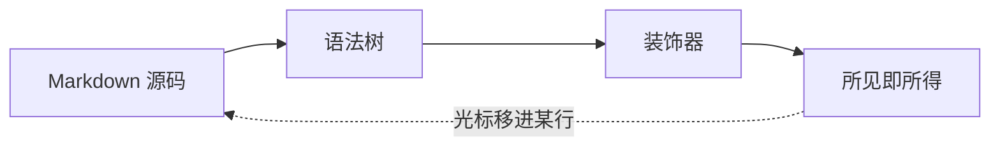
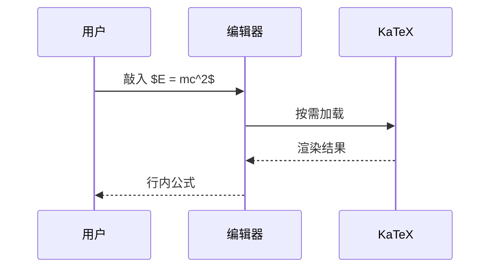
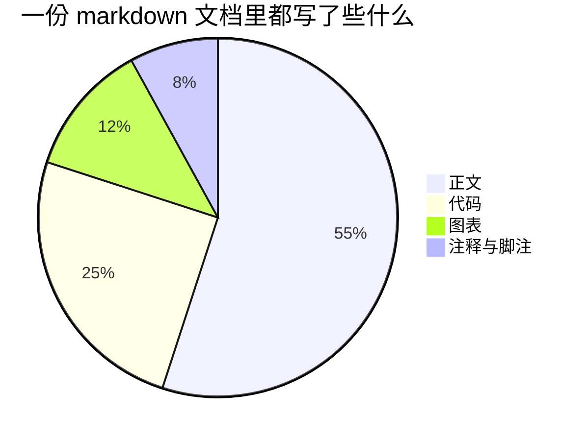

[TOC]

# Markdown 效果全览

这篇文档只有一个目的：**把 Markdown 能写出来的东西，一样不漏地摆一遍**。
用 Cursive 打开它，光标移到哪一行，哪一行的源码才回显 —— 其余部分始终是排版好的成品。

> [!tip] 四个可以立刻试的
> 在空行上打一个 `/` 弹出块菜单（`/table`、`/callout`、`/h2`…，中文打 `/表格` 也找得到）·
> `⌘/` 切源代码模式对照着看 · `⌥⌘F` 只点亮当前段落 · `⇧⌘T` 开关右边的大纲。
> 底部那条格式栏嫌挡路，点它右端的折角收起来就是。

先看主角。这颗图标画的是一个开口朝右的 **C**，缺口上停着一根蓝色光标：
写到哪儿，C 就断在哪儿，整颗图标里唯一发光的东西就是它。


大尺寸的标志（128px 以上）怀里多一行：灰色方块是 Markdown 标记，后面那节墨色胶囊是排好版的成品 ——
标记与成品共用同一段文字，由光标决定你此刻看见哪一面。


## 一、标题一共六级

### 这是三级标题

#### 这是四级标题

##### 这是五级标题

###### 这是六级标题

标题 1–6 都能用 `⌘1`–`⌘6` 直接套，`⌘0` 退回正文。右边的大纲会按层级列出本文的每一个小节。

## 二、行内标记

一段话里能混进多少种修饰？粗体 **像这样**，斜体 *像这样*，粗斜体 ***像这样***，
删除线 ~~删掉不要了~~，高亮 ==划重点==，行内代码 `npm run build`。

上下标写作 x^2^ 与 H~2~O，上标那个 `^` 不会被当成 LaTeX 的幂符号 —— 这是刻意选方言的结果。

想显示字面量就转义：\*这不是斜体\*，\`这不是代码\`，\==这不是高亮\==。

链接有两种写法：[带文字的链接](https://codemirror.net/docs/) 和
[相对路径指向仓库里的文件](./README.md)。按住 ⌘ 点击就跟着它走：外部地址交给浏览器，
本地的 `.md` 在新标签里打开，`#锚点` 直接滚到那一节（比如[回到开头](#markdown-效果全览)）。
**文件名带空格不用特意转义**：`[部署手册](我的 笔记.md)` 这样写就行 —— 标准 Markdown 要求
写成 `<我的 笔记.md>` 或 `我的%20笔记.md`，两种写法这里也都认。

Emoji 用短代码写：:tada: :sparkles: :rocket: :coffee: —— 源码里是 `:tada:`，成品里是 🎉。

## 三、列表

### 无序列表

- 第一项
- 第二项
  - 嵌套一层
  - 再嵌套一层
    - 还能更深
- 第三项

### 有序列表

1. 第一步：把光标移进这一行，源码回显
2. 第二步：按 `⌘/` 切到源代码模式，整篇一起看
3. 第三步：再按一次切回来

### 任务列表

复选框是真的能点的，点一下就把 `[ ]` 改成 `[x]`：

- [x] 实时预览：标记按光标显隐
- [x] 表格就地编辑
- [x] 数学公式与 mermaid
- [ ] 这一项还没勾上：点一下方框试试
- [ ] 勾上之后，源码里的 `[ ]` 就变成了 `[x]`

## 四、引用

> 引用块不必写得很长，一句话就够了。
> 第二行仍然属于同一个引用 —— 它靠 `>` 起头，不靠缩进。

嵌套引用也认，但**只有里层会被识别成告示块**，不递归：

> 外层是普通引用
> > 里层可以再引一次

引用里照样能放**粗体**、`代码` 和 [链接](https://codemirror.net)。

## 五、分隔线

三条短横线就是一条分隔线：

---

再补一条星号写法：

***

## 六、告示块：13 种全上

类型写在 `> [!类型]` 里，可以写中文别名，也可以写 GitHub 那套大写英文写法。

> [!note] 笔记
> 默认类型，最常用的一块。同一档配色还有 `[!info]`（信息）这个别名。

> [!info] 信息
> `info` 与 `note` 共用「笔记」这一档 —— 两者只是名字不同。

> [!summary] 摘要
> `summary` / `abstract` / `tldr` 三选一，都落到这一档。

> [!todo] 待办
> `todo`：适合把一段没做完的事单独框出来。

> [!tip] 提示
> 圆头火苗，最温和的一档。别名还有 `hint` / `important`。

> [!success] 成功
> `success` / `check` / `done` 都指向这里 —— 绿色对勾。

> [!question] 疑问
> `question` / `help` / `faq`：用来放「这里为什么这么写」。

> [!warning] 注意
> 黄色三角，`warning` / `caution` / `attention` 都算。

> [!danger] 危险
> 红色闪电，最重的一档。

> [!failure] 失败
> `failure` / `fail` / `missing`：跑挂了、对不上的那些。

> [!bug] 缺陷
> `bug`：已知但还没修的东西写在这儿。

> [!example] 示例
> `example`：放一段可以直接抄的写法。

> [!quote] 引用
> `quote` / `cite`：把一段别人的话单独框起来。

标题后面加一个 `-`，这一块默认就是收起的，点标题展开：

> [!note]- 这一条默认折起
> 类型名后面多写一个 `-` 而已。文档里的「操作步骤」这类长内容很适合折叠，
> 不挡阅读路径，需要时再点开。

## 七、表格

用冒号控制对齐，左边 `:---`、中间 `:--:`、右边 `---:`：

| 构件 | 靠什么实现 | 状态 |
| :--- | :--- | :--: |
| 实时预览引擎 | CodeMirror 6 装饰器 | ✅ |
| 原生外壳 | Swift + WKWebView | ✅ |
| 数学公式 | KaTeX（按需加载） | ✅ |
| 图表 | mermaid（按需加载） | ✅ |
| 导出 HTML / PDF / 长图 | 与预览共用一棵语法树 | ✅ |

格子里也能写行内语法，而且不影响列宽对齐：

| 写进格子 | 格子里长什么样 |
| :--- | :--- |
| `**粗体**` | **粗体** |
| `~~删除~~` | ~~删除~~ |
| `==高亮==` | ==高亮== |
| `[链接](./README.md)` | [链接](./README.md) |
| `x^2^` | x^2^ |

点进任意一格就能直接改，不会回落成源码；底部会浮起一条工具栏管增删行列与整列对齐。

## 八、代码

行内代码是 `` `npm run build` `` 这样，围栏代码块是这样的：

```ts
/** katex 没到手时返回 null：调用方先摆源码占位，加载完再换掉 */
export function renderMath(tex: string, display: boolean): string | null {
  if (!katexMod) {
    void loadKatex()
    return null
  }
  return katexMod.renderToString(tex, { displayMode: display, throwOnError: false })
}
```

```bash
npm install
npm run build          # 构建 renderer 到 out/renderer
./shell-swift/build.sh # 编译原生壳
./shell-swift/cursive-shell a.md
```

```yaml
title: Markdown 效果全览
tags: [markdown, cursive]
katex: lazy
```

```python
def wrap(text: str, width: int = 80) -> str:
    """按显示宽度折行，中文按两格算。"""
    return "\n".join(text[i : i + width] for i in range(0, len(text), width))
```

没有语言的围栏也能用，不带高亮：

```
这是一个纯文本块。
缩进、全角空格、→ 箭头都原样保留。
```

要在块里显示三个反引号本身，就把外层围栏写成四个：

````
```ts
const nested = '四个反引号包住三个反引号'
```
````

## 九、数学

行内公式 $E = mc^2$ 混在句子里不会撑行，块级公式独占一行居中：

$$
\int_{-\infty}^{\infty} e^{-x^2}\,\mathrm{d}x = \sqrt{\pi}
$$

矩阵、分组、希腊字母照常：

$$
\begin{pmatrix} a & b \\ c & d \end{pmatrix}
\begin{pmatrix} x \\ y \end{pmatrix}
= \begin{pmatrix} ax + by \\ cx + dy \end{pmatrix}
$$

一个刻意的边界：`$100` 这种货币写法**不吃**公式，还是老老实实显示成 `$100`。

## 十、图表

流程图：



时序图：



饼图：



语错了也不必慌：mermaid 会把源码原样留下，并在旁边给出报错，不会静默吞掉你的内容。

## 十一、图片

图片语法与链接同族，只是多一个 `!`。相对路径按文档所在目录解析 ——
这一份在仓库根目录，所以下面这几个都写得出来：


`brand/favicon.svg` 是 16–32px 专用的简化版，笔画按像素重新加粗过，小尺寸上比缩下去的图标清楚。

尺寸写在目的地后面：`=128x128` 就是 128 像素见方，只写宽不写高则按原始比例。
下面两张是同一个图标 —— 第一张 `=128x128`，第二张 `=64x`：


矢量之外，位图照样认：下面是这个应用自己的界面（`docs/shots/light.png`，同一份文档浅色主题下的样子）。


几个行为约定：

- 点击图片会开灯箱放大，`Esc` 关闭。
- 加载失败时显示的是**解析后的完整路径**，不是 alt —— 路径写错还是文件缺失，一眼分得清。
- 粘贴或拖拽进来的图片会自动落盘到 `assets/` 目录（默认在文档同级，设置里可以改成工作区根目录），正文里只留一行相对路径。
- 没写尺寸的图片由文件本身决定显示多大（CSS 限制在栏宽以内、高度不超过 60vh）。
- 尺寸只认 `=宽x高` / `=宽x` 这两种紧挨着写的形状；`= 600 x 400`（等号后带空格、x 两侧带空格）
  不是这条语法，会原样显示成文字。

## 十二、脚注

脚注引用写成 `[^1]`，定义写在文末[^1]。这条定义平时折叠成一行，光标移进去才摊开成源码[^2]。

同一个脚注可以被引多次[^1]，编号不会重复。

## 十三、其他

- **YAML front matter**：本文件开头那一个 `---` 块就是，标题、作者、标签、日期都在这儿。它是元数据，不会被当正文渲染。
- **目录**：开头的 `[TOC]` 会展开成本文的目录树。
- **原始 HTML**：写进正文的 HTML 标签会被转义成字面量，所见即所得 —— 看到的 `<div>` 就是 `<div>`，不是一块 div。
- **零损耗**：缓冲区里始终是未经修改的 Markdown 文本，渲染全部由装饰器叠加，所以没编辑过的地方保存下来字节不变。

## 结语

上面这些构件加起来，够写一篇技术文章、一份产品说明，或者一本小册子了。
如果想知道某个标记在 Cursive 里到底怎么处理，把光标移进那一行看源码，是最快的验证方式。

[^1]: 脚注定义的第一条。定义块里的行内语法不渲染 —— 解析器把定义整块当叶子节点。

[^2]: 第二条脚注。定义可以写多行，但它们会一起折叠在文末。