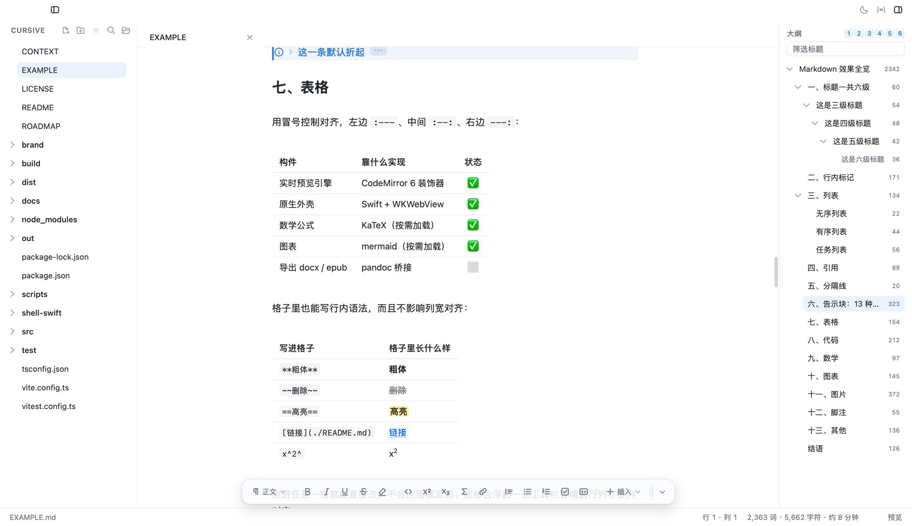
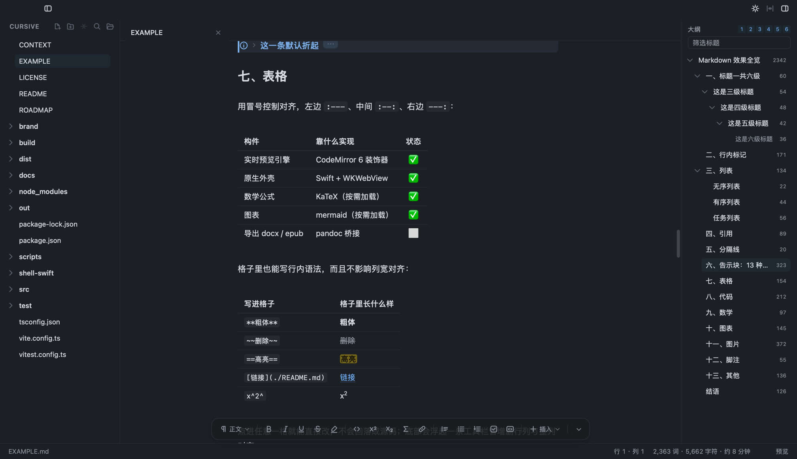

# Cursive

**macOS 上的 Markdown 编辑器：单窗格、无分屏、打字即渲染。**
标记默认隐藏，光标移进哪一行，哪一行才回显源码 —— 所见即所得的全部秘密就这一句。

[](https://github.com/lawrence1912/cursive/actions/workflows/ci.yml)


[](LICENSE)
[](https://linux.do/)



> 图里这份文档就是仓库根目录的 [`EXAMPLE.md`](EXAMPLE.md) —— 装好之后直接打开它，
> 表格 / 公式 / 告示块 / mermaid / 代码块语言条都能当场点着玩。

渲染层是纯 [CodeMirror 6](https://codemirror.net)，原生能力由 `shell-swift/` 里的
Swift + AppKit + WKWebView 壳提供：**仓库里没有 Electron**，打出来的 app 10 MB 出头。

## 示例文档

[`EXAMPLE.md`](EXAMPLE.md) 把这个编辑器认得的 Markdown **一样不漏地摆了一遍**，
既是上手导览，也是每次改渲染必须走查的那份验收稿：

六级标题 · 行内标记与转义 · 三种列表（复选框可点）· 引用与嵌套 · 分隔线 ·
**13 种告示块**（含折叠）· 表格（对齐 / 格内行内语法 / 就地编辑）· 代码块（含四反引号嵌套）·
KaTeX 行内与块级公式 · mermaid 流程图 / 时序图 / 饼图 · 图片（尺寸语法 / 灯箱 / 落盘规则）·
脚注 · YAML front matter 与 `[TOC]`。

把光标移进任意一行看它的源码，是搞清楚「某个标记在 Cursive 里到底怎么处理」最快的办法。



深色之外还有跟随系统、护眼两套，以及扫 `~/Library/Application Support/cursive/themes/*.css`
的用户自定义皮肤。

## 斜杠命令

空行上打 `/` 弹出块菜单：每行左边是图标、右边是关键词，继续打字筛选，回车插入。

| 输入 | 结果 |
|---|---|
| `/h2` ⏎ | `## `，光标落在标记后面 |
| `/table` ⏎ | 三列两行的空表，光标落在表头第一格 |
| `/callout` ⏎ | `> [!NOTE]` 与一行正文，光标落在正文行 |
| `/code` ⏎ | 一对围栏，光标落在中间的空行 |

十九条：标题 1–6、无序 / 有序 / 任务列表、引用、代码块、表格、分隔线、告示块、
公式块、流程图、图片、脚注、目录。关键词、显示名、别名一起参与匹配，所以 `/cal`、
`/callout`、`/告示` 都能选中「告示块」，`/todo` 与 `/待办` 都能选中「任务项」。

只在行首触发，前面只允许缩进：`2026/09/16`、`src/renderer` 这类正文里的斜杠不弹面板，
代码块、公式、front matter、列表项与引用块里同样不弹。删关键词与插骨架是同一个事务，
⌘Z 一次回到输入 `/` 之前。

菜单里每一条都是一个 `fmt:*` 命令，与原生「格式」菜单、格式栏、快捷键、命令面板
派发的是同一条；五个入口共用一份实现。

## 特性

**写起来**

- 实时预览引擎：标记按光标显隐，回显粒度三档 —— 元素 / **整行**（默认）/ 整块
- GFM 表格**真渲染 + 就地编辑**：点进格子直接改、不回落源码，底部浮动工具栏管增删行列与对齐，还有悬停 +/− 手柄
- KaTeX 公式（行内 / 块级，货币符号不吃）· mermaid 图表（随主题配色）· 13 种告示块（可折叠）
- 脚注 · `==高亮==` · 上下标 · emoji 短代码 · `[TOC]`
- 代码块：藏掉围栏 + 顶部语言条（语言选择器 / 一键复制）
- 图片：截图粘贴与拖拽自动落盘 `assets/` · 尺寸语法 `=128x128` · 点击灯箱放大
- 格式化命令三个入口：底部悬浮格式栏（贴着状态栏坐，右端一颗折角随手收起）· 原生「格式」菜单 · 快捷键
- 输入规则（表格 / 代码块骨架）· 列表智能（Tab 升降级、自动重编号）
- **智能粘贴**：HTML→MD，**表格、任务项、`==高亮==`、上下标一样不丢**；URL 自动包链接
- **斜杠命令**：空行上打 `/` 弹块菜单（十九条），关键词与中文名都能搜
- **自动补全**：`:` emoji · `> [!` 告示块 · `[^` 脚注 · `](#` 标题锚点 · ` ``` ` 代码语言

**当编辑器用**

- 多标签（每标签独立 EditorState）· 多窗口（一个窗口 = 一个工作区）
- 标签右键：关闭 / 关闭左边 / 关闭其他 / 关闭右边 / 关闭所有（中键也能关一个）
- **命令面板**（⇧⌘P，列的就是整份菜单）· **快速打开**（⌘T，按名字模糊跳文件）
- **链接跳转**（⌘ + 点击）：外部地址给浏览器 · 本地 `.md` 开标签（`#锚点` 一并跳过去）· `#锚点` 就地滚 · 其它文件交给默认应用；**文件名带空格照样认**（`[部署手册](我的 笔记.md)`，不必写成 `<…>` 或 `%20`）
- **版本历史**：每次保存留一份快照，浮层里看差异、一键回滚（撤销键还能再撤回来）
- 文件树：新建 / 重命名 / 拖拽移动 / 删除进废纸篓 / 在 Finder 中显示
- 大纲：滚动跟随 · 折叠 · 层级档位 · 过滤框 · 每节字数 · 拖拽重排
- 查找替换浮层（面板内计数）+ 跨文件搜索（壳侧流式、可取消、点击跳转并选中那一处）
- 自动保存 + 崩溃恢复 + 外部变更监听 · 最近文件 · Finder 双击 · Dock 菜单
- 状态栏：光标行列 · 选区字数 · 阅读时间 · 点一下弹详细统计（CJK 分词）
- 多光标（⌘D 选择下一个匹配）· 系统拼写检查（设置里开，默认关）

**输出与外观**

- 导出 HTML：**单文件** —— 样式内联、图片可嵌 base64、mermaid 烘成静态 SVG、公式走 MathML
- 导出 PDF：真分页 · A4/Letter · 三档页边距 · 页码 · **书签目录**（预览侧栏里能跳）
- **复制为富文本**（⌥⇧⌘C）：直接粘进邮件 / 飞书 / Notion；有选区就只复制选区
- 四套主题（浅 / 深 / 跟随系统 / 护眼）+ 自定义皮肤 CSS · 字号 / 行距 / 栏宽 / 衬线
- 专注模式（压暗非当前段落）· 打字机模式（光标行定高）· 源代码模式
- 界面语言中文 ⇄ English 全量切换，原生菜单与对话框一起跟随

做过什么、接下来做什么，见 [`ROADMAP.md`](ROADMAP.md)。

## 安装

需要 macOS 12 或更新。两条路，选一条。

### 一、下载现成的包

到 [Releases](https://github.com/lawrence1912/cursive/releases) 拿 `Cursive-<版本>.dmg`，打开后把 Cursive 拖进「应用程序」。
装好之后 `.md` 的默认打开方式就归 Cursive；想换回去，在任意 md 文件上「显示简介 → 打开方式」里改。
**现成的包是 arm64（Apple Silicon）** —— Intel 机器走下面第二条自己编译，一样是三条命令。

**第一次打开会被 macOS 拦住**，提示「无法验证开发者」或「已损坏，无法打开」。

任选一种放行，做一次就够：

```bash
xattr -dr com.apple.quarantine /Applications/Cursive.app
```

或者不用终端：双击被拦之后打开「系统设置 → 隐私与安全性」，往下翻会多出一行
「仍要打开」，点它。（新版 macOS 已经取消了「右键 → 打开」那个老办法，只剩这一处。）

### 二、自己编译（不会被拦）

本机编译出来的包**不带隔离属性**，Gatekeeper 不管它，省掉上面那一步：

```bash
npm install
./shell-swift/release.sh                 # 测试 + E2E 全绿才出包 → dist/Cursive.app
CURSIVE_DMG=1 ./shell-swift/release.sh   # 顺带出 dist/Cursive-<版本>.dmg
```

只需要 Node 和 Xcode Command Line Tools（`xcode-select --install`），**不需要装 Xcode.app**。

打出来的二进制部署目标钉在 macOS 12（`build.sh` / `make-app.sh` 里的 `TARGET`）。
这一条不能省：不指定的话跟着工具链默认值走，而那个值会随系统升级往上跳 ——
跳到比你正在跑的系统还高时，命令行里一切正常，双击 .app 却会被 LaunchServices
以 `-10825` 拒掉。

**签名公证是有意不做的**：Developer ID 证书 + 公证要 Apple Developer Program（$99/年），
换来的只是「下载版少点一次『仍要打开』」。这个项目选择把这笔钱省掉，代价在上面写明 ——
想要零提示就走自己编译这条路，它本来就不经过 Gatekeeper。

## 用起来

### 文件与窗口

| | |
|---|---|
| ⌘N / ⇧⌘N | 新建标签 / 新建窗口 |
| ⌘O / ⇧⌘O | 打开文件 / 打开文件夹（**开新窗口**：一个窗口 = 一个工作区） |
| ⌘T | 快速打开（按名字模糊跳文件） |
| ⌘S / ⇧⌘S | 保存 / 另存为 |
| ⌘W / ⇧⌘W | 关闭标签 / 关闭窗口 |
| ⇧⌘E / ⌘P | 导出 HTML / 导出 PDF |
| ⌥⇧⌘C | 复制为富文本（有选区则只复制选区） |
| ⌘, | 设置（主题 / 排版 / 语言 / 拼写检查） |

「文件 → 版本历史…」没给快捷键 —— ⌥⌘H 是系统的「隐藏其他」，而它本来就是偶尔用一次的东西（⇧⌘P 命令面板里一样找得到）。

### 视图与查找

| | |
|---|---|
| ⌘\ / ⇧⌘T | 显示或隐藏文件树 / 大纲 |
| ⌘/ | 源代码模式 |
| ⌥⌘F / ⌥⌘T | 专注模式 / 打字机模式 |
| ⌃⌘D / ⌃⌘F | 浅色 ⇄ 深色 / 全屏 |
| ⇧⌘P | 命令面板 |
| ⌘D | 选择下一个匹配（多光标） |
| ⌘F / ⌥⌘R | 查找 / 摊开替换那一行 |
| ⌘G / ⇧⌘G | 下一处 / 上一处 |
| ⇧⌘F | 在文件夹中查找（跨文件搜索） |

### 格式

| | |
|---|---|
| `/`（空行上） | 斜杠命令：块菜单（标题 / 列表 / 表格 / 告示块 / 公式块…） |
| ⌘B / ⌘I / ⌘U | 粗体 / 斜体 / 下划线 |
| ⇧⌘X / ⌃⌘C / ⌘K | 删除线 / 行内代码 / 链接 |
| ⇧⌘H / ⌃⌘= / ⌃⌘- | 高亮 / 上标 / 下标 |
| ⌘1 – ⌘6 / ⌘0 | 标题 1–6 / 正文 |
| ⇧⌘K / ⇧⌘Q / ⌃⌘T | 代码块 / 引用 / 表格 |
| ⇧⌘[ / ⇧⌘] / ⇧⌘C | 无序列表 / 有序列表 / 任务项 |
| ⌃⌘M | 行内公式（块级公式在「插入」菜单里） |
| ⇧⌥⌘V | 粘贴为纯文本 |
| ⌘ + 点击链接 | 跟着链接走：外部给浏览器 · 本地 `.md` 开标签 · `#锚点` 就地跳 |

标题栏两端还有三处入口：左边一颗开关文件树，右边一块是「深色 / 栏宽 / 大纲」。

命令行：`cursive 文件.md` 打开文件，`cursive 目录/` 在侧边栏打开那个文件夹。

## 它是怎么搭的

```
src/
├─ renderer/      CodeMirror 6 编辑器 + 应用界面（纯 Web，产物 out/renderer）
└─ shared/        两端共用：类型、换行/BOM 指纹、分词计数
shell-swift/      Swift + AppKit + WKWebView 原生壳（单文件渐进，优先 AppKit）
```

**源码即真相。** 编辑器缓冲区里始终是未经修改的 markdown 文本，渲染效果全部由 CodeMirror
装饰器叠加上去，不改动文本本身。于是：保存零损耗（没编辑过的地方字节完全不变）、
源代码模式只是把装饰器关掉的一次 `Compartment.reconfigure`、撤销与搜索与输入法由 CM6 兜底。
`src/shared/textfile.ts` 守住这条承诺的边界 —— CRLF/CR 与 BOM 读进来时摘成「指纹」，
写回时原样还原，`test/textfile.test.ts` 对着语料做字节级往返断言。

**实时预览**在 `src/renderer/editor/live-preview/`：一个 ViewPlugin 只遍历**可视区域**的语法树，
产出三类装饰器 —— `Decoration.replace({})` 藏掉 `**` `#` `>` 这些标记，
`replace({ widget })` 换出圆点、复选框、图片、表格，`Decoration.line({ class })` 管标题字号与引用边框。
块级（跨行）装饰**只能走 StateField**，ViewPlugin 的会直接报错；输入法合成期间一律不重算装饰；
widget 必须实现 `eq()`。方言在 `markdown-lang.ts`：CommonMark + GFM + YAML front matter，
刻意**不用** `markdownLanguage`（它自带的上下标扩展会把 `$e^{-x^2}$` 里的 `^` 吃掉）。

**渲染层只认 `window.api`**（签名见 `src/shared/types.ts` 的 `CursiveApi`），不碰任何原生能力 ——
这正是把 Electron 换成 Swift 壳时 renderer 零改动的原因。壳侧 1:1 实现该契约，新增通道要三处同步：
`types.ts` ↔ `main.swift` ↔ `CONTEXT.md`。两个自定义协议缺一不可：`app://r/<路径>` 服务渲染资源
（WKWebView 下 `file://` 的 ES module 因 opaque origin 会静默失败），
`safe-file://local/<绝对路径>` 加载文档里的本地图片。

**导出**（`src/renderer/export/`）把整份文档渲染成语义 HTML，**和实时预览共用同一棵语法树、
同一批解析函数** —— 编辑器只渲染视口而导出渲染全文，两条路径对同一段 markdown 必须是同一种理解，
所以这里一处小解析器都不另写（`test/export.test.ts` 拿块级装饰和导出产物逐块对账）。
PDF 就是把这份 HTML 用 `NSPrintInfo` 真打印出来，纸张 / 页边距 / 分页归壳侧一处管。

每一处「为什么是这样」以及踩过的坑，都在 [`CONTEXT.md`](CONTEXT.md) 里。

## 参与开发

```bash
npm install
npm run build                    # 构建 renderer 到 out/renderer
./shell-swift/build.sh           # 编译原生壳 → shell-swift/cursive-shell
./shell-swift/cursive-shell a.md # 开发运行（资源查找 Bundle → cwd → exe 相对）
```

| 命令 | 做什么 |
|---|---|
| `npm run dev` | 浏览器里开发 renderer（HMR，但拿不到 `window.api`，原生功能不可用） |
| `npm test` | 单测：往返保真 + 方言 + 表格 + 导出对账 |
| `npm run typecheck` | 渲染层 + 共享层类型检查 |
| `npm run icon` | 从 `brand/app-icon.svg` 重出 `build/icon.png` + `icon.icns` |
| `./shell-swift/release.sh` | 类型检查 + 单测 → 构建 → 编译壳 → E2E → 组装 `dist/Cursive.app` |

没法手动点界面时（沙箱、自动化），壳内置探针：

```bash
CURSIVE_SMOKE=1 ./shell-swift/cursive-shell test/fixtures/kitchen-sink.md
# +3s 写 /tmp/cursive-shell-check.json  （DOM：api/cm/侧栏/状态栏/标题栏/拖拽条）
# +4s 写 /tmp/cursive-shell-e2e.json    （read→save 逐字节往返 + 装饰计数 + 图片加载），然后退出
```

> **探针是会改东西的**：改标题层级、往表格里打字、追加 marker（自动保存还会落盘），
> `treeProbe` 还会在**树根目录里真的建文件、改名、移动、删除**。所以永远只在**夹具的副本**上跑
> （`release.sh` 就是先把 fixtures 拷进 `/tmp/cursive-e2e/` 才跑的），别拿自己在乎的文件去试。
> 只想拍张图就加 `CURSIVE_SMOKE_SHOT_CLEAN=1`，那条路跳过全部探针：文档一个字不动，树根一个文件不碰。

`CURSIVE_SMOKE` 之外启动就是正常交互应用，绝不自动退出。全部环境变量（截图、主题走查、
导出 PDF/HTML、崩溃恢复竞态…）见 `CONTEXT.md` 的「自检探针 / E2E」一节。

改动请配着 `./shell-swift/release.sh` 跑一轮再提 —— 它是这个项目唯一的「绿灯」。

| 文档 | 讲什么 |
|---|---|
| [`CONTEXT.md`](CONTEXT.md) | 架构、IPC 契约、每一个踩过的坑（改代码前先读这份） |
| [`ROADMAP.md`](ROADMAP.md) | 现状盘点、对标主流 WYSIWYG、P0–P4 清单 |
| [`EXAMPLE.md`](EXAMPLE.md) | Markdown 效果全览，也是走查渲染的验收稿 |
| [`docs/table-editing.md`](docs/table-editing.md) | 表格就地编辑的完整设计 |
| [`brand/README.md`](brand/README.md) | 品牌资产：标志怎么读、配色、用法、重出图标 |

## 已知限制

- 表格的「整理对齐」是显式命令（工具栏那颗「整理」），不会自动跑 —— 平时改一格只动那一格，源码里的列宽会变参差，这是保存零损耗的代价
- 表格单元格里粘贴多行文本会被压成一行（格内粘贴退化成原生纯文本）
- 代码块的语言条只在「光标不在围栏行上」时出现：把光标挪到围栏行会回显 ```` ```ts ```` 源码（要改语言也可以直接在那行改）
- 导出的 PDF / HTML 只有浅色一套（导出物会进别人的浏览器、会被打印，跟着阅读者的系统外观走等于同一份文档两个样子）；脚注定义里的行内语法不渲染
- 告示块的类型表是封闭的：`> [!xyz]` 这种表里没有的类型不成卡片，仍旧是普通引用；嵌套的 `> > [!note]` 只有里层那块算告示块，不递归
- 跨文件搜索只扫 `.md/.markdown/.mdown/.mkd/.txt`，跳过 `node_modules`/`dist`/`out` 这类目录；上限 800 处命中 / 6000 个文件，触顶会在结果区注明「已截断」
- 自定义皮肤是叠在内置主题之后的一张 CSS，写坏了只能删文件重开（没有出错回滚）
- 多窗口之间只共享 localStorage 里的偏好；窗口位置只记第一个窗口的
- 尚无 pandoc 导出（docx / epub）
- 没有签名公证，也没有自动更新：下载版第一次打开要手动放行一次（见「安装」），新版本要自己回 Releases 拿

## 许可

[MIT](LICENSE) © 2026 Lawrence。

依赖也都是宽松许可，不冲突：CodeMirror 6、@lezer/\*、KaTeX、mermaid、turndown 均为 MIT。