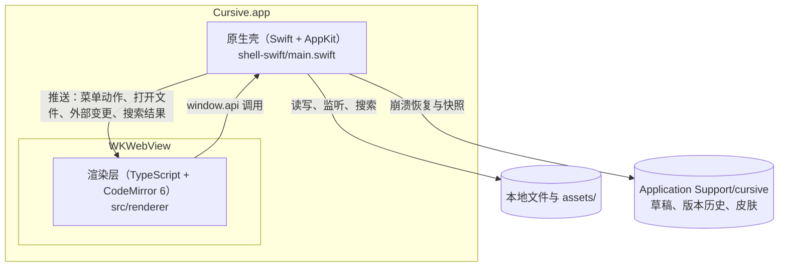
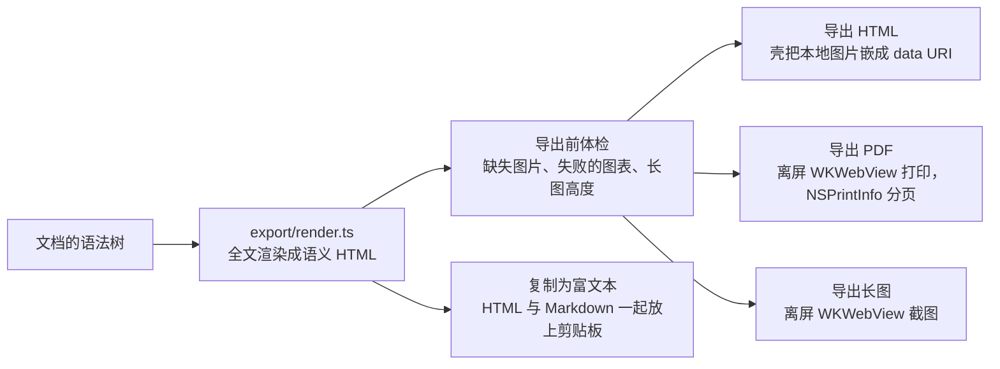

# Cursive 架构说明

这份文档面向想读懂、改动 Cursive 代码的人：各层怎么分工、数据怎么流动、哪些原则不能破。
它只做概述和指路；每个决定的完整来由、踩过的坑与契约的逐条记录在 [`CONTEXT.md`](../CONTEXT.md)，
构建与测试见[开发指南](development.md)，功能用法见[用户指南](user-guide.md)。

## 总览

Cursive 是一个原生 macOS 应用：Swift + AppKit 写的外壳负责窗口、菜单和一切需要系统能力的事，
编辑器与界面是一套运行在 WKWebView 里的 TypeScript 程序，核心是 CodeMirror 6。两边只通过一份 IPC 契约说话。



| 层 | 位置 | 负责 |
|---|---|---|
| 原生壳 | `shell-swift/main.swift` | 窗口与原生菜单、文件读写与外部变更监听、跨文件搜索与替换、剪贴板、导出 PDF 与长图、打印、检查更新 |
| 渲染层 | `src/renderer/` | 编辑器与实时预览、文件树、标签、大纲、各种面板、导出 HTML 的渲染 |
| 共享层 | `src/shared/` | IPC 契约类型（`types.ts`）、换行符与 BOM 指纹（`textfile.ts`）、字数统计、路径工具 |

构建链只有 Vite：`npm run build` 把渲染层打包到 `out/renderer`，壳在运行时加载它。仓库里没有 Electron，应用运行时也不需要 Node。

## 目录结构

```
src/
├─ renderer/
│  ├─ main.ts          启动序列、标签与窗口状态、菜单动作分发
│  ├─ editor/          CodeMirror 扩展：方言、格式命令、补全、斜杠命令、折叠、链接…
│  │  └─ live-preview/ 实时预览：行内装饰、块级 widget、表格、回显规则
│  ├─ ui/              界面：文件树、标签栏、大纲、命令面板、设置、状态栏、冲突与历史面板…
│  ├─ export/          全文渲染成 HTML（PDF 与长图也用这一份）
│  ├─ i18n/            中英文字典（zh.ts 是 key 的真相源）
│  └─ themes/          base.css（设计 token 与界面）、live-preview.css
└─ shared/             两端共用的类型与纯函数
shell-swift/           原生壳（单文件渐进的 main.swift）与构建、打包、原生测试脚本
test/                  vitest 单测、夹具、原生专项用的页面探针
scripts/               图标生成、语法树调试
brand/                 品牌资产
```

## 壳与渲染层的通信

- **渲染层只认 `window.api`。** 签名定义在 `src/shared/types.ts` 的 `CursiveApi`，壳在 `main.swift` 里一比一实现；渲染层不直接调用任何原生能力。当初把 Electron 换成 Swift 壳时渲染层零改动，靠的就是这条边界。
- **三种消息**：调用（返回 Promise，如 `read`、`save`、`searchFiles`）、单向通知（如 `setDocState`）、壳推给渲染层的事件（菜单动作、打开文件、外部变更、跨文件搜索的分批结果等）。
- **桥本身**由壳注入的脚本提供：调用方法有一张白名单，推送事件有一张固定的监听表。新增调用要登记进白名单（漏了会在调用时报 “not a function”），新增推送事件要登记进监听表（漏了会在订阅时出错）。
- **契约有版本号**，当前是 v41。改动契约要三处同步：`types.ts`、`main.swift`、`CONTEXT.md`（ROADMAP 非功能红线第 4 条）；壳侧发现契约缺口，先补文档再改代码。
- **启动**：壳把启动时要打开的文档直接随页面注入（`window.__cursiveInitialDoc`），不等渲染层就绪再走一趟 IPC；渲染层就绪的信号是 `window.__cursive` 被赋值时回传给壳的消息。

两个自定义协议缺一不可：

| 协议 | 用途 | 为什么需要 |
|---|---|---|
| `app://r/<路径>` | 加载 `out/renderer` 的页面与脚本 | WKWebView 在 `file://` 下按 opaque origin 处理 ES module，会静默加载失败 |
| `safe-file://local/<绝对路径>` | 加载文档里引用的本地图片 | 让页面读到本地图片，同时由壳控制能读什么；路径按百分号编码逐级解码 |

页面的 CSP 是 `default-src 'self'`：页面里的脚本连不上网络，需要联网的检查更新由壳来做（文档里引用的网络图片仍按 `img-src` 正常加载）。
文件树里的新建、重命名、移动、删除，以及跨文件搜索与替换，都经过壳侧的路径检查（`safeTarget`），只允许落在当前工作区或当前文档所在目录之下。

## 编辑器核心

### 文本与方言

编辑器缓冲区里永远是文件的原始 Markdown 文本，只在读入时摘掉 BOM、把换行统一成 LF，写回时按「指纹」还原（`src/shared/textfile.ts`，壳侧有同一逻辑的 Swift 实现）。
排版效果全部由 CodeMirror 的装饰器叠加，所以没编辑过的字节保存后不变，源代码模式也只是把装饰关掉。

方言定义在 `editor/markdown-lang.ts`：CommonMark + GFM + YAML front matter，外加行内与块级数学、`==高亮==`、上下标、emoji 短代码、脚注、告示块、`[TOC]`、图片尺寸语法和带空格的链接目的地。
这里刻意没用 `@codemirror/lang-markdown` 的 `markdownLanguage`：它自带的上下标扩展会把 `$e^{-x^2}$` 里的 `^` 吃掉。
代码块里的语言由 `@codemirror/language-data` 按需加载。

### 实时预览

实时预览在 `editor/live-preview/`，分两条路：

- **行内装饰**由一个 ViewPlugin 产生，只遍历当前可视范围的语法树。三类装饰：`Decoration.replace({})` 藏掉 `**`、`#`、`>` 这些标记；`Decoration.replace({ widget })` 换成圆点、复选框、图片等组件；`Decoration.line({ class })` 管标题字号、引用边框这类行样式。
- **块级（跨行）装饰只能由 StateField 提供**（ViewPlugin 提供会直接报错）：表格、块级公式、mermaid、`[TOC]`、脚注定义等组件由 `blockField` 统一产生，告示块、章节与列表的折叠状态也各自放在 StateField 里。`blockField` 按「光标前后的回显区间 + 改动范围 + 新解析出的范围」增量重建，碰到围栏配对、目录依赖这类无法局部推断的情况退回全量。

**回显规则**（`live-preview/reveal.ts`）决定哪些范围显示源码。引擎支持三种粒度：只露光标所在的行内元素（`node`）、整行（`line`）、整块（`block`）；现在固定使用 `line`，没有设置入口。

几条贯穿实时预览的约束：

- 输入法组字期间不重算装饰；本轮不重算时必须先把旧装饰映射到新文档（`editor/carry.ts`）。
- 每个 widget 都要实现 `eq()`，块级 widget 要给出贴近真实值的 `estimatedHeight`，量到的真实高度会记住并落盘（`height-store.ts`），根节点不能有上下外边距。
- 需要语法树的地方统一走 `editor/syntax.ts`（`parsedTree`、`primeTree`、`parsedExtent`）：CodeMirror 的解析是异步分块的，front matter 又让语法树成为两层的混合解析，直接读树会拿到半截。
- KaTeX、mermaid、turndown 与各种代码语言都是按需动态加载，不进首屏。

### 表格就地编辑

表格 widget 里的格子是 `contenteditable` 的编辑岛（`live-preview/table.ts`）：CodeMirror 的选区是「正在编辑哪一格」的唯一真相，widget 只把它镜像成 DOM 焦点；
打字只替换那一格文字对应的源码区间，同一行其余字节不动；增删行列、对齐、整理都是返回事务的纯函数，工具栏与手柄共用。
完整设计见[表格就地编辑](table-editing.md)。

### 命令与键盘

- 所有带 ⌘ 的快捷键都是原生菜单项。壳把带 ⌘ 的按键交还给菜单系统，菜单动作经 `menu` 事件送到渲染层，由 `handleMenu` 分发；动作名是 `types.ts` 里的 `MenuAction` 联合类型。
- 格式命令只有一份实现（`editor/fmt.ts`），菜单、格式栏、快捷键、命令面板和斜杠菜单五个入口都调用它，所以幂等、多光标、一步撤销对每个入口都成立。
- 撤销、重做、全选也走菜单动作交给 CodeMirror，而不是 WebKit 自己的编辑命令（WebKit 的撤销栈和全选范围都只认 DOM 里那一屏）。
- 渲染层显示的快捷键文字统一取自 `ui/shortcuts.ts`；`test/shortcuts.test.ts` 读 `main.swift` 的菜单对账，用户指南里的快捷键表也在对账范围内。

## 文件与数据安全

- **读写**：壳自己读原始字节、识别 BOM，解码成正文加指纹交给渲染层；写回时按指纹还原，使用原子写入。
- **写前比对**：保存请求带着渲染层认为的磁盘内容（正文加指纹），壳在写入那一刻再读一次，对不上就拒绝写入并回报 `stale`，渲染层按外部修改处理。只靠文件监听挡不住「外部刚改完、事件还没到」的那一瞬。
- **外部变更**：壳给每个打开的文件挂监听，给文件树缓存着的每一级目录挂 kqueue，都用尾部去抖。干净的标签静默重新载入，有未保存修改的标签进入冲突面板（`ui/conflict.ts`），处理完之前暂停这个文件的自动保存。
- **自动保存与崩溃恢复**：停止输入 2 秒、切标签或失焦时保存；未命名文档写进 `scratch/`，启动时只恢复「上次留下的」草稿，而且只交出一次。
- **版本历史**：每次写盘后留一份快照（`history/<路径摘要>/<时间戳>.md`），去重并按「最近 50 份且 30 天内、至少 10 份」清理；恢复是一次普通编辑。
- **会话**：按工作区根记住开着哪些有路径的标签和阅读位置（`ui/session.ts`），只记位置不记内容。

## 导出管线

导出与实时预览共用同一棵语法树和同一批解析函数，导出这边一个小解析器都不另写，`test/export.test.ts` 拿块级装饰与导出产物逐类对账。



- 导出 HTML 的图片字节不经过 IPC：渲染层只在 `` 里写明路径，读盘和编码由壳完成。
- PDF 就是把同一份 HTML 交给 `NSPrintOperation` 打印出来：纸张、页边距和分页只由壳侧的 `NSPrintInfo` 决定；页码以注记加在页边距里，书签目录按标题以增量更新的方式追加进文件。
- 长图在离屏 WKWebView 里撑到整篇高度后截图；超过 32768 像素时可以按顶层块的边界分成几张。
- 导出样式只有浅色一套，会跟随设置里的排版；正文里的原始 HTML 一律转义。

## 状态与持久化

| 状态 | 存在哪儿 | 说明 |
|---|---|---|
| 偏好（主题、排版、语言等） | 渲染层 localStorage `cursive.prefs` | 真相在渲染层；外观、语言、图片落脚这几项会推给壳，多窗口之间经 `syncPrefs` 广播 |
| 会话 | localStorage `cursive.session:<工作区根>` | 只记有路径的标签 |
| 面板与模式开关、大纲折叠等 | localStorage `cursive.*` | |
| 块级 widget 的高度记忆 | localStorage `cursive.widgetHeights` | 排版条件变了就整份作废 |
| 启动外观、PDF 纸张与页边距 | UserDefaults | 壳侧 |
| 崩溃恢复草稿、版本历史、自定义皮肤 | `~/Library/Application Support/cursive/` 下的 `scratch/`、`history/`、`themes/` | 自检时可用 `CURSIVE_SMOKE_SUPPORT` 整个换成临时目录 |

折叠、表格光标、查找命中这类编辑状态只存在于编辑器状态里，从不写回文档。

## 性能设计

- 行内装饰只建视口内的部分；块级装饰增量重建，一次按键的装饰开销远低于一帧。
- 解析优先使用 CodeMirror 已有的语法树快照，只在快照不够长时才强制同步解析。
- 文档内查找的命中位置随事务增量维护，计数和滚动条刻度共用一份。
- 预算写在 ROADMAP 第四节（1 万行 + 50 个公式 + 10 张图，一帧 16ms），由 `test/perf.test.ts`、`test/block.test.ts` 的断言和人工发起的 `shell-swift/measure.py` 守着。
  [性能基线](perf-baseline-2026-10-09.md)是在 M1 Pro、macOS 27、60 Hz 屏幕上的实测记录，用来发现回归，不是对所有机器的承诺。

## 设计原则与约束

这些约束在 ROADMAP 里展开，是任何改动的准入条件：

- **四个结构性判断**（[ROADMAP 第二节](../ROADMAP.md#二四个结构性判断)）：键盘入口一律走原生菜单；跨行的东西一律走 StateField；大数据不过 IPC 桥；编辑器里的「态」不写回文档。
- **非功能红线**（[ROADMAP 第四节](../ROADMAP.md#四非功能红线)）：保存零损耗、输入法安全、性能预算、契约三处同步、每个新功能都有 E2E、渲染层只认 `window.api`。
- **有意不做**（[ROADMAP 第三节](../ROADMAP.md#三有意不做总表)）：签名公证、自动更新、分屏、插件、双链与标签面板等，每一条都写明了理由。
- **早期决策**（2026-09-11）：只做 macOS，不引入 Rust / Tauri；壳用 Swift + AppKit + WKWebView，优先 AppKit 而不是 SwiftUI。

## 继续深入

- [`CONTEXT.md`](../CONTEXT.md) 开头的导读列出了各节内容：「功能要点」讲每个模块为什么这么做，「架构与契约」是契约的逐条记录，「已踩坑」是改代码前最该搜一遍的地方。
- [表格就地编辑](table-editing.md)：最复杂的一块交互的完整设计。
- [开发指南](development.md)：构建、测试分层、自检探针与调试。
