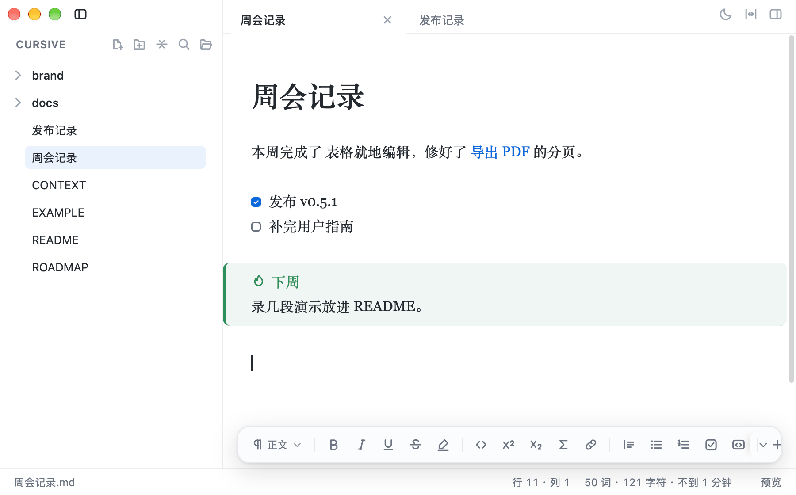

# Cursive 用户指南

这份指南讲怎么安装 Cursive、每个功能怎么用、能设置什么，以及目前有哪些限制。
内容对应 v0.5.1；概览见 [README](../README.md)，Markdown 效果的完整样例见 [`EXAMPLE.md`](../EXAMPLE.md)，
装好之后用 Cursive 打开它，边读边试最快。

- [安装与第一次打开](#安装与第一次打开)
- [编辑方式](#编辑方式)
- [写作](#写作)
- [表格](#表格)
- [公式、图表与其他内容](#公式图表与其他内容)
- [文件、标签与工作区](#文件标签与工作区)
- [搜索与跳转](#搜索与跳转)
- [保存、恢复与版本历史](#保存恢复与版本历史)
- [导出、打印与分享](#导出打印与分享)
- [外观与设置](#外观与设置)
- [快捷键](#快捷键)
- [已知限制](#已知限制)

## 安装与第一次打开

### 系统要求

| 项目 | 说明 |
|---|---|
| 系统 | 需要 macOS 12 或更新。安装包按 macOS 12 编译；日常开发与验收在 macOS 27 上进行，更早的系统版本没有逐一实测 |
| 芯片 | 同一个安装包同时包含 Apple Silicon 与 Intel 两份代码。Intel 那一份是交叉编译的，只在 Apple Silicon 的 Rosetta 下做过冒烟测试，还没有在真 Intel Mac 上运行过；遇到问题请[提 issue](https://github.com/lawrence1912/cursive/issues) |
| 体积 | v0.5.1：dmg 约 5 MB，装好的 `Cursive.app` 约 11 MB |

### 下载与安装

1. 到 [Releases](https://github.com/lawrence1912/cursive/releases/latest) 下载 `Cursive-<版本>.dmg`。
2. 打开 dmg，把 Cursive 拖到旁边的「应用程序」文件夹。
3. 第一次打开时按下一节放行一次。

### 第一次打开：放行没有公证的应用

Cursive 只做了 ad-hoc 签名，没有经过 Apple 公证 —— 公证需要付费的 Apple Developer 账号，项目选择不做（理由见 [ROADMAP 第三节](../ROADMAP.md#三有意不做总表)）。
所以从网上下载的安装包第一次打开时，macOS 的 Gatekeeper 会拦下它，提示「无法验证开发者」「Apple 无法验证它是否包含恶意软件」，个别情况下是「已损坏，无法打开」。
放行一次之后，以后都能正常双击打开。

**方法一：在系统设置里放行（推荐，各版本通用）**

1. 双击 Cursive，看到拦截提示后关掉对话框（不要选「移到废纸篓」）。
2. 打开「系统设置 → 隐私与安全性」。macOS 12 上是「系统偏好设置 → 安全性与隐私 → 通用」。
3. 在「安全性」一栏会看到 Cursive 被阻止的说明，点「仍要打开」，按提示输入登录密码或使用触控 ID。
   这个按钮只在被拦之后的一段时间里（约一小时）出现，没看到就先再双击一次 Cursive。
4. 在随后弹出的对话框里确认打开。

**方法二：按住 Control 点按（macOS 14 及更早）**

在「应用程序」文件夹里按住 Control 点按 Cursive（或右键）→「打开」→ 在对话框里点「打开」。
macOS 15 起系统取消了这条路，只能用方法一。

**方法三：在终端里去掉隔离标记（备选）**

只在前两种方法走不通时使用，比如提示「已损坏」而系统设置里没有出现「仍要打开」：

```bash
xattr -dr com.apple.quarantine /Applications/Cursive.app
```

先弄清楚它做了什么：浏览器下载的文件会被系统打上 `com.apple.quarantine`（隔离）标记，Gatekeeper 据此在第一次打开时检查这个应用。
这条命令删掉 `Cursive.app` 里的隔离标记，系统打开它时就不再做这项检查。

- 代价是这一份 Cursive 不再经过 Gatekeeper 把关，它是否可信只能由你自己判断。请只对从本仓库 Releases 页面下载的安装包这样做。
- 影响范围只是这一个应用，不改变系统设置；不需要、也不要为此关闭整个 Gatekeeper。
- 以后下载的新版本会重新带上隔离标记，需要再放行一次。

**方法四：自己编译**

本机编译出来的包不带隔离标记，Gatekeeper 不会拦，步骤见[开发指南](development.md)。

### 让双击 .md 用 Cursive 打开

Cursive 会把自己登记为 `.md`、`.markdown`、`.mdown`、`.mkd` 的编辑器；双击时由哪个应用打开，取决于系统里已有的设置。
想改：在 Finder 里选中任意一个 `.md` 文件 →「文件 → 显示简介」→「打开方式」选 Cursive → 点「全部更改…」。
想换回原来的编辑器，在同一处改回去。

也可以从终端打开：`open -a Cursive 笔记.md` 打开文件，`open -a Cursive 某个文件夹` 把文件夹开成一个工作区窗口。

### 检查更新

「Cursive → 检查更新」**只在你点它时联网**：向 GitHub 查一次最新发布版本的版本号，不带 token、cookie 或任何标识（只有系统网络库默认的 User-Agent），也不记住谁点过。
结果显示在状态栏，有新版本时给一颗「去看看」，把 Releases 页面交给浏览器；它不自动下载、不安装，也不替换「应用程序」里的 Cursive。
应用不在启动时检查、不在后台轮询、没有任何遥测。

注意：文档里引用的网络图片（比如 ``）会在显示时照常加载，那是文档内容自己的请求。

### 数据存在哪儿

- **你的文档**：就在原来的 `.md` 文件里。Cursive 不建库、不建索引，也不往文件里写任何隐藏标记。
- **粘贴或拖入的图片**：存进文档同级的 `assets/`（设置里可以改成工作区根目录的 `assets/`）。
- **应用自己的数据**：在 `~/Library/Application Support/cursive/` 下 —— `scratch/` 是未命名文档的崩溃恢复草稿，`history/` 是版本历史快照，`themes/` 放你的自定义皮肤。
- **偏好与会话**：主题、字号、语言、上次开着的标签等存在应用的 WebKit 本地存储里；PDF 的纸张与页边距选择记在系统偏好（UserDefaults）里。

## 编辑方式

### 光标在哪一行，哪一行显示源码

打开文档看到的是排好版的样子：`**`、`#`、`>` 这类标记藏起来，表格、公式、图表和图片直接画成成品。
光标移进哪一行，那一行就回到 Markdown 源码，可以直接改；光标离开，它重新排版。

- 回显以行为单位：只有光标所在的那一行露出源码，其余部分保持排版。块级公式和 mermaid 图表是整块的，光标移进去时整块显示源码。
- 选中一段文字时，选区覆盖的部分也会露出源码。全选（⌘A）会让整篇暂时回到源码，取消选区就恢复。
- 表格点进去是直接编辑格子，不回到源码（见[表格](#表格)）；代码块只在光标落在围栏那一行时露出 ```` ```ts ```` 这样的源码。



### 四种视图模式

| 模式 | 快捷键 | 说明 |
|---|---|---|
| 源代码模式 | ⌘/ | 整篇显示原始 Markdown，再按一次切回；切换前后看到的是同一处 |
| 只读阅读模式 | ⌥⌘L | 按标签开关。渲染效果固定，光标走到哪儿都不翻回源码；打字、粘贴、勾选任务、拖图改尺寸、格式命令都不会改到文档，选择、复制、查找、折叠、链接跳转照常。标签上有一把锁，状态栏的「只读」点一下即退出 |
| 专注模式 | ⌥⌘F | 只有光标所在的段落保持正常颜色，其余文字变淡；图片、表格、代码块不加遮罩 |
| 打字机模式 | ⌥⌘T | 光标所在行固定停在窗口约四成高的位置，正文跟着滚动 |

### Cursive 什么时候会改动你的文本

- **只有你自己做的编辑。** 打开、浏览、保存都不会重排或「规范化」你的 Markdown；没碰过的内容保存后逐字节不变。
- 文件原来的换行符风格（LF 或 CRLF）和开头的 UTF-8 BOM 保存时原样还原。一个文件里混用了几种换行符时，保存会统一成其中占多数的那一种。
- 少数命令会整块改写，都只在你明确执行时发生，而且都能撤销：表格「整理对齐」、「格式化 LaTeX」、在大纲里拖拽重排章节、版本历史回滚、跨文件替换。
- 折叠状态、表格里的光标、查找结果这类编辑状态不写进文件。

## 写作

### 斜杠命令

在空行开头输入 `/` 弹出块菜单：左边是图标、右边是关键词，继续输入可以筛选，回车插入。

| 输入 | 结果 |
|---|---|
| `/h2` ⏎ | `## `，光标落在标记后面 |
| `/table` ⏎ | 三列两行的空表，光标在表头第一格 |
| `/callout` ⏎ | `> [!NOTE]` 加一行正文，光标在正文行 |
| `/code` ⏎ | 一对代码围栏，光标在中间的空行 |

一共十九条：标题 1–6、无序列表、有序列表、任务列表、引用、代码块、表格、分隔线、告示块、公式块、流程图、图片、脚注、目录。
关键词、显示名和别名一起参与匹配，所以 `/cal`、`/callout`、`/告示` 都能选中「告示块」，`/todo` 和 `/待办` 都能选中「任务项」。

- 只在行首触发，前面只允许有缩进：正文里的 `2026/09/16`、`src/renderer` 不会弹菜单。
- 代码块、公式、front matter、列表项和引用块里不弹。
- 删掉关键词和插入骨架是同一步操作，⌘Z 一次就回到输入 `/` 之前。

### 格式命令

同一套格式命令有五个入口：「格式」与「插入」菜单、底部格式栏、快捷键、命令面板（⇧⌘P）和斜杠菜单。它们走的是同一份实现，所以：

- 已经加粗的文字再按一次 ⌘B 就是取消，标题、列表同理；
- 多个光标时每一处各自生效；
- 一次命令就是一步撤销。

底部格式栏贴着状态栏，嫌它挡路可以点右端的折角收起；「视图 → 格式栏」可以整条关掉。

### 操作提示

Cursive 没有新手教程，只在用得上的地方提示一句：

- 空白文档里浮着两行淡字：空行输入 `/` 插入块、⇧⌘P 查找所有命令。打出第一个字就消失，只读文档里不显示。
- 链接的悬停说明里写着「⌘ + 点击打开」；格式栏「插入」下拉的最后一行提醒斜杠菜单也能插入。

嫌这些提示多余，点提示里的「不再显示」即可，设置里的「操作提示」能再打开。

### 列表与输入规则

- 列表里 Tab / ⇧ + Tab 升级、降级，有序列表随之重新编号（保留原来的 `.` 或 `)` 写法）。回车续写下一项，在空项上回车退出列表，任务项会续出 `- [ ]`。
- 在表头行（如 `| 姓名 | 年龄 |`）末尾回车，自动补上分隔行；输入 ```` ```ts ```` 回车，自动补上闭合围栏。
- ⌥ + ↑ / ⌥ + ↓ 把光标所在的块整块上下移动（在列表里移动的是那一项连同子项）；两块之间的空行留在原处，有序列表的编号保持不变。
- ⌥⌘[ 折叠或展开光标所在的一节（从标题到下一个同级或更高级的标题）或带子项的一条列表，行尾也有一颗把手。折叠只是显示状态，不写进文件。

### 粘贴

- 从网页、飞书、Notion 等处复制带格式的内容，粘贴时转成 Markdown：标题、列表、链接、表格、任务项、`==高亮==`、上下标都保留，网页里的样式和脚本不会混进来。
- 选中一段文字后粘贴网址，会变成 `[文字](网址)` 链接。
- ⌥⇧⌘V 粘贴为纯文本。
- 截图可以直接粘贴，图片落盘规则见[图片](#图片)。

### 自动补全

| 输入 | 补全什么 |
|---|---|
| `:smi` | emoji 短代码（冒号后至少要有一个字符，`10:30` 这种不会弹） |
| `> [!` | 告示块类型 |
| `[^` | 文档里已有的脚注 |
| `](#` | 本文的标题锚点，补出来的锚点一定点得动 |
| `](` | 工作区里的文件 |
| `\`（在公式里） | LaTeX 命令 |
| ```` ``` ```` 之后 | 代码块语言（只列有语法高亮的语言） |

### 多光标与拼写检查

- ⌘D 选中下一处相同的文字，同时编辑多处。
- 系统拼写检查默认关闭，可在设置里打开；打开后由 macOS 标出拼写错误，右键可以改正。

## 表格

表格始终以真表格显示。**点进任意一格就能直接改字**，不会变回一堆竖线；改一格只动那一格的源码，同一行其他单元格的空格与对齐写法一个字节都不变。


| 按键 | 作用 |
|---|---|
| Tab / ⇧ + Tab | 下一格 / 上一格；在最后一格按 Tab 新增一行 |
| 回车 | 同一列的下一行；在最后一行新增一行 |
| ↑ / ↓ | 同一列上下移动；移出表格就回到正文 |
| ← / → | 在格首或格尾时跨到相邻格子，其余时候在格内移动光标 |
| Esc | 退出就地编辑，把整张表显示成 Markdown 源码 |
| ⌘Z | 撤销，表格结构的改动也能撤 |

- 编辑时表格下方浮出工具栏：在上方或下方插入行、在左侧或右侧插入列、删除行列、设置整列对齐、整理对齐、删除表格。
- 鼠标悬停在格子上时，那一列的上边框和那一行的左边框会出现 `＋` / `−` 手柄，点一下就插入或删除。
- 格子里可以写行内语法：`**粗体**`、`` `代码` ``、`$x^2$`、链接、emoji 在非编辑状态下都会渲染。
- **从 Excel 或 Numbers 粘贴几行几列**：从光标所在的格子起向右下填，行列不够自动补，⌘Z 一次全部撤回。只复制了一格时，就把那一格的文字插到光标处。
- 「**整理对齐**」是唯一会重写整张表源码的操作，只在你点它时执行：按显示宽度把各列补齐（中文按两格算）。平时改一格不会触发它，所以源码里的列宽可能参差，这是「只改你改的地方」的代价。
- 单元格里粘贴普通的多行文本会合并成一行（Markdown 表格的一行放不下换行），状态栏会说明。

完整的设计说明见 [表格就地编辑](table-editing.md)。

## 公式、图表与其他内容

### 公式

- `$…$` 是行内公式，`$$…$$` 是块级公式，用 KaTeX 渲染。
- 开头的 `$` 后面和结尾的 `$` 前面不能是空格，结尾的 `$` 后面不能紧跟数字，所以 `$100` 这类金额不会被当成公式。
- 公式有语法错误时显示红色源码，不会让整页出错。

**格式化 LaTeX**：把光标放进公式，或选中一段 LaTeX，选择「格式 → 格式化 LaTeX」（命令面板里搜 `LaTeX` 也行）。

- 选区包含多条完整公式时批量整理；⌘A 全选后执行可以处理整篇文档里的公式；⌘Z 一次撤销。
- 块公式整理为独立的定界符、环境缩进和分行，行内公式只整理间距。
- 注释、命令参数和 `\text{…}` 里的内容保留；有语法错误或整理后渲染会变样的公式跳过并提示。
- 保存时不会自动格式化。

### 图表

`mermaid` 代码块会画成图表（流程图、时序图、饼图等），配色跟随当前主题。
图表语法有误时保留源码并显示错误信息，不会吞掉内容。

### 告示块

写法是引用块的第一行加 `> [!类型]`，类型后面可以接自定义标题：

```markdown
> [!tip] 小提示
> 正文写在这里。
```

一共 13 种，别名与 GitHub 的大写写法（`[!NOTE]`、`[!WARNING]` 等）都认：

| 类型 | 显示名 | 别名 |
|---|---|---|
| `note` | 笔记 | |
| `info` | 信息 | |
| `abstract` | 摘要 | `summary`、`tldr` |
| `todo` | 待办 | |
| `tip` | 提示 | `hint`、`important` |
| `success` | 成功 | `check`、`done` |
| `question` | 疑问 | `help`、`faq` |
| `warning` | 注意 | `caution`、`attention` |
| `failure` | 失败 | `fail`、`missing` |
| `danger` | 危险 | `error` |
| `bug` | 缺陷 | |
| `example` | 示例 | |
| `quote` | 引用 | `cite` |

- `> [!note]- 标题` 默认折起，`> [!note]+ 标题` 默认展开，点标题前的三角切换。折叠状态不写进文件。
- 不在表里的类型（如 `[!xyz]`）仍按普通引用显示；嵌套的 `> > [!note]` 只有里层算告示块。

### 代码块

- 围栏行藏起来，顶部换成一条语言条：左边是语言名，右边是复制按钮。点语言名可以换语言，列表里只有能高亮的语言；`py`、`yml`、`rs` 这类常用简称也认得。
- 光标移到围栏那一行时回显 ```` ```ts ```` 源码，也可以直接在那一行改语言。
- 要在代码块里显示三个反引号，把外层围栏写成四个。

### 图片

- 截图直接粘贴、或从 Finder 拖进来，图片会复制到 `assets/` 目录并在光标处插入相对路径。粘贴的截图命名为 `<文档名>-<时间戳>.png`，拖进来的文件保留原名（重名时加序号）。存到文档同级还是工作区根目录，在设置的「图片存到」里选。
- 尺寸写在地址后面：``；只写宽度（`=300x`）时按原图比例。也可以拖图片右下角的手柄改尺寸，松手才写回文档，⌘Z 一步撤回。带标题的图片（``）不支持拖动改尺寸。
- 文件名带空格时写成 ``。
- 点击图片放大查看，Esc 关闭。
- 图片加载失败时显示解析后的完整路径，方便判断是路径写错还是文件不在。

### 链接

- ⌘ + 点击链接跟过去：网址交给浏览器；本地 `.md`、`.markdown`、`.mdown`、`.mkd`、`.txt` 在当前窗口开新标签（带 `#锚点` 的会跳到那一节）；`#锚点` 在本文内滚动；其他本地文件交给系统默认的应用。
- 文件名带空格可以直接写：`[部署手册](我的 笔记.md)`。标准 Markdown 要求的 `<我的 笔记.md>` 和 `我的%20笔记.md` 两种写法也都认。
- 引用式链接 `[文字][id]`、裸网址和 `<网址>` 同样能跟。
- 跟不过去时状态栏会说明原因：文件不在、本文没有这个锚点，或者系统打不开它。

### 其他语法

- 脚注：`[^1]` 显示为上标，悬停能看到定义，点击跳到定义；文末的定义平时折成一行。没有对应定义的引用保持原样显示。
- `==高亮==`、上标 `x^2^`、下标 `H~2~O`、emoji 短代码 `:tada:`。
- `[TOC]` 单独一行时展开成本文目录，点击跳转。
- YAML front matter 显示成属性表：键名一列、值一列，数组值拆成一颗颗标签。⌘ + 点击一颗标签，就拿它搜索整个工作区（`tags:` 之外的数组也算，比如点 `authors: [Alice]` 里的 Alice）。这不建索引、没有标签面板，生成的搜索式留在搜索框里，可以接着改。
- 写进正文的 HTML 标签按原文显示，不会被当成网页执行。

## 文件、标签与工作区

### 打开文件与文件夹

- ⌘O 打开文件；⇧⌘O 打开文件夹。**一个窗口就是一个工作区**：打开文件夹会开一个新窗口，以它为文件树的根；当前窗口还是刚开出来的空白状态时则直接用它。
- 在 Finder 里双击 `.md`、拖到 Dock 图标上，或者 `open -a Cursive 文件.md`：如果已有窗口的工作区包含这个文件，就在那个窗口里开新标签，否则新开一个窗口。
- 「文件 → 打开最近」和 Dock 图标的右键菜单里有最近打开的文件。
- 重新打开一个工作区时，会回到上次在这个工作区里开着的那几个标签和阅读位置（只恢复存过盘的文件）。

### 文件树

- ⌘\ 显示或隐藏。顶部工具栏有新建文件、新建文件夹、完全折叠、搜索、打开其他文件夹五个按钮。
- 只列出 Cursive 能打开的文档（`.md`、`.markdown`、`.mdown`、`.mkd`、`.txt`）和文件夹，排序方式与 Finder 一致（`第2章` 排在 `第10章` 前面）。
- 右键菜单：新建、重命名、删除、在 Finder 中显示、在此文件夹中搜索。删除是移进废纸篓，状态栏会给一颗「撤销」，8 秒内可以撤回。
- 拖动文件或文件夹可以移动位置；拖到边缘会自动滚动，悬停在收起的文件夹上一会儿它会自己展开。开着的标签跟着改指向。
- 别的程序在这个文件夹里增删文件，文件树会自己更新。
- 键盘操作（文件树有焦点时）：↑ / ↓ 移动，← / → 收起或展开，回车打开，空格以预览方式打开，直接输入名字的开头跳到那个文件，F2 重命名，⌘ + ⌫ 移到废纸篓。

### 标签

- 每个标签有自己的撤销历史、光标和滚动位置。⌘N 新建空白标签，⌘W 关闭，⌃⇥ / ⌃⇧⇥ 切换，拖动标签可以调整顺序，中键点击关闭。
- **单击预览、双击留下**：在文件树里单击文件，它在一个「预览标签」里打开（标题是斜体），再单击别的文件会在同一个标签里替换，标签栏不会越点越长。双击（或回车）才打开成普通标签；在预览里改一个字、双击标签或右键「保持打开」，它也会留下。不想要这个行为，在设置里关掉「单击预览」。
- 标签右键菜单：关闭、关闭左边、关闭其他、关闭右边、关闭所有、设为只读、重新打开关闭的标签。批量关闭时有未保存的标签会逐个询问，任何一次「取消」都会停下整批操作。
- ⌥⇧⌘T 重新打开刚关闭的标签，带回光标、滚动位置和只读状态；已经开着的文件不会开出第二份。

### 大纲

⇧⌘T 显示或隐藏右侧大纲：

- 跟随滚动高亮当前所在的小节，点击跳转；
- 每个标题可以折叠；顶部的 1–6 选择显示到第几级标题；过滤框按标题文字筛选；
- 每一节后面显示字数；
- 拖动标题可以把整节移到别处；右键可以复制本节锚点、在后面新建同级标题、升级或降级。

### 状态栏

从左到右：文件名；光标所在的行与列；字数（「N 词 · N 字符 · 约 N 分钟」，有选区时显示选中部分）；查找的命中计数；保存状态；正文缩放比例（不是 100% 时才出现，点一下恢复）；当前显示的是「预览」还是「源代码」；只读时还有一格「只读」。
点字数会弹出详细统计：词数、字符数、不含空格的字符、中日韩字数、拉丁词数、段落、行数和阅读时间。阅读时间按中文每分钟 300 字、英文每分钟 200 词分别计算再相加。

## 搜索与跳转

### 命令面板与快速打开

- ⇧⌘P 命令面板：菜单里的每一条命令都能在这里按名字搜到，右边一列是它的快捷键。
- ⌘T 快速打开：按名字模糊匹配工作区里的文件。输入 `:120` 跳到当前文档第 120 行，`readme:120` 跳到那个文件的第 120 行。

### 后退与前进

⌥⌘← / ⌥⌘→ 在跳转过的位置之间后退与前进，就像浏览器。记录的是明确的跳转：大纲、`[TOC]`、链接与锚点、跨文件搜索结果、快速打开、文件树；可以跨文档，那个标签关了会按路径重新打开。普通滚动和手动切换标签不记录。

### 文档内查找替换

- ⌘F 在右上角打开查找框，框里显示「第几处 / 共几处」，命中位置同时画在滚动条上；可以切换区分大小写、整词匹配和正则表达式。
- ⌘G / ⇧⌘G 下一处 / 上一处；⌥⌘R 展开替换那一行。
- 用中文输入法输入查询时，组字过程中不会拿拼音去搜。

### 跨文件搜索与替换

⇧⌘F 把文件树的位置换成搜索面板（再按一次或点工具栏的放大镜切回）：

- 支持普通文字和正则表达式、区分大小写、整词匹配；结果边搜边按文件分组显示，可以随时取消；点一处结果会打开那个文件并选中命中的文字。
- **缩小范围**：在文件树里右键文件夹选「在此文件夹中搜索…」，面板上会显示当前范围，点 × 回到整个工作区。还可以展开「范围条件」，写包含或排除的路径：用逗号分隔，`*` 匹配一层里的任意字符，`**` 跨越多层；不带斜杠的模式匹配任何一层（`drafts` 会排除每一层的 drafts 文件夹），带斜杠的从范围的根算起（`docs/**`）。
- 只搜 `.md`、`.markdown`、`.mdown`、`.mkd`、`.txt`，跳过 `node_modules`、`dist`、`out`、`build`、`vendor`、`Pods`、`.git` 这些目录。最多 800 处命中、6000 个文件，单个文件超过 2 MB 跳过；超出时结果会注明「已截断」，并给出「缩小范围」。
- **替换**：替换串按原样文本处理（`$1` 这类捕获组不展开），结果列表里每一处都可以单独取消勾选，只改列着且勾选的那些。每个文件改之前先存一份版本历史；改完状态栏有一颗「撤销」，8 秒内可以全部撤回。文件在搜索之后被改过、原文对不上时，整份跳过并在结果里说明。

### 检查引用

「文件 → 检查引用…」（命令面板里也有）检查当前文档里指向本地文件、标题锚点和图片的引用，把找不到的列成清单：写在文档里的地址、第几行、为什么。
回车跳到源码并选中那段地址。只检查当前这一份文档，按需执行，不联网检查网址，也不改动文档。

在文件树里把文档拖到别的目录、或另存到别处之后，如果相对路径因此失效，状态栏会说明有几处找不到并给「查看」。Cursive 不会替你复制图片或改写链接。

## 保存、恢复与版本历史

- **自动保存**：停止输入 2 秒、切换标签或窗口失去焦点时自动保存。未命名的文档保存到崩溃恢复目录，不会弹出保存面板。
- **保存状态**显示在状态栏，跟着当前这个标签走：「未保存」「正在保存…」「已保存 HH:MM」「保存失败」。保存失败的提示不会自己消失，旁边有「重试」和「另存为…」；失败之后自动保存暂停，避免反复报错。
- **崩溃恢复**：应用意外退出后，再打开时会把上次没来得及保存的未命名草稿恢复成标签。
- **文件在别处被改了**：没有未保存修改的标签自动重新载入，保留滚动位置和光标。有未保存修改时，Cursive 把两边的差异摆出来，三选一：用磁盘上的版本、保留我的版本、把我的版本另存一份（两份都留着）。处理完之前这个文件的自动保存一直暂停，不会替你决定覆盖谁。
- **文件被删除或改名**：自动保存停下，不会把它原地写回来；状态栏给出「另存为…」和「重新创建」。
- **打不开文件**时会说明原因：不是 UTF-8 编码、文件不存在、没有读取权限，或其他读写错误，并给出对应的下一步（在 Finder 中显示、刷新文件树、重试）。

### 版本历史

「文件 → 版本历史…」（命令面板里也有）：

- 文档每次写进磁盘都会留一份快照，内容与上一份相同时不重复保存。
- 打开后左侧是版本列表，右侧是该版本与当前文档的差异；点「恢复此版本」用它替换当前内容，这是一次普通编辑，⌘Z 可以撤回。
- 每个文件保留最近 50 份且 30 天内的快照，但至少留 10 份。快照存在 `~/Library/Application Support/cursive/history/`。
- 只记录有路径的文档；未命名的草稿由崩溃恢复负责。

## 导出、打印与分享

| 方式 | 入口 | 结果 |
|---|---|---|
| 导出 HTML | ⇧⌘E | 单个 HTML 文件：样式内联，图片默认嵌入（保存面板里可以取消），mermaid 图表转成静态 SVG，公式用 MathML |
| 导出 PDF | ⌥⌘P | 真分页 PDF：A4 或 Letter，页边距窄 12 mm / 标准 18 mm / 宽 25 mm，可加页码，按标题生成书签目录 |
| 导出长图 | 「文件 → 导出为长图…」 | 整篇（或选中的那一段）渲染成一张 2 倍分辨率的 PNG，方便发到聊天软件 |
| 打印 | ⌘P | 系统打印面板，「存储为 PDF」也在这里 |
| 复制为富文本 | ⌥⇧⌘C | 同时放上 HTML 与 Markdown 原文，可以直接粘进邮件或在线文档；有选区时只复制选区 |

- 三种导出共用同一份渲染结果，长相一致；和编辑器里看到的也是同一种解析。
- 设置里的字体、字号、行距和栏宽会带进导出物（PDF 的版心宽度由纸张和页边距决定），但配色始终是浅色：导出物会进别人的浏览器、会被打印。复制为富文本不带这些排版设置，以免在别人的邮件里显得突兀。
- 导出的 HTML 里，正文中的原始 HTML 按文字显示，`javascript:` 链接只保留文字；折叠的告示块全部展开。
- **导出前体检**：导出 HTML、PDF 或长图之前，如果有缺失的本地图片或画不出来的 mermaid 图表，会先列出来；选「照样导出」继续，选某一处就跳到源码。
- **长图超高**：一张长图最高 32768 像素。超出时在弹出保存面板之前就会提示，可以按段落边界分成几张导出（文件名依次加 `-1`、`-2`……，遇到重名会整组换名，不覆盖已有文件），或者先选中一段只导出那一段；坚持导成一张则截在上限处。
- PDF 里标题不会孤零零落在页底，宽表格的长网址会折行而不是被裁掉。

## 外观与设置

### 设置面板

⌘, 打开设置，改动立即生效并自动记住；「恢复默认」一键还原：

| 设置 | 选项 |
|---|---|
| 主题 | 跟随系统、浅色、深色、护眼 |
| 正文字体 | 衬线、无衬线 |
| 字号、行距、栏宽 | 拖动调整 |
| 语言 | 简体中文、English |
| 图片存到 | 文档同级、工作区根 |
| 拼写检查 | 关（默认）、开 |
| 操作提示 | 开（默认）、关：空白文档里的两行提示等 |
| 单击预览 | 开（默认）、关 |
| 自定义样式 | 选择一张自定义皮肤 |

### 主题与自定义皮肤

- ⌃⌘D 在浅色与深色之间切换，标题栏右上角的月亮 / 太阳按钮作用相同；「视图 → 主题」里还有跟随系统和护眼。
- **自定义皮肤**：把 `.css` 文件放进 `~/Library/Application Support/cursive/themes/`，重开 Cursive 后在「设置 → 自定义样式」里选它。皮肤叠加在内置主题之后，只写想改的几条变量即可，示例见 [`themes/暖橙.css`](themes/暖橙.css)，可改的变量在 `src/renderer/themes/base.css` 开头。
- 皮肤写坏了导致界面无法操作时，用原生菜单「视图 → 停用自定义皮肤」，不受页面样式影响；选过哪一张仍然记着，改好之后再启用。

### 缩放与窗口

- ⌘+ / ⌘- / ⌥⌘0 以及触控板捏合只缩放正文，文件树、标签栏和状态栏保持原样；比例显示在状态栏右下角，点一下恢复 100%。
- 标题栏左侧按钮开关文件树，右侧三个按钮依次是深色切换、栏宽、大纲。双击标题栏空白处按系统设置缩放或最小化窗口。
- 窗口位置和大小按工作区记住。

### 界面语言

设置里切换简体中文与 English，菜单、对话框和全部界面文字一起切换，不用重启。
文档内容不翻译：告示块的类型名、代码语言名和产品名保持原样。

保存与打开面板的按钮、系统自动加进菜单的条目（如「开始听写」）、系统给出的错误原因，这一层文字由 macOS 提供，跟随系统语言，不跟随应用里的语言开关。

## 快捷键

下面列出的快捷键都是原生菜单里的项，菜单、命令面板和本页写的是同一个键。
剪切、拷贝、粘贴、重做、隐藏、最小化、退出等 macOS 通用快捷键照常可用，下面不再列出。

### 文件

| 快捷键 | 命令 |
|---|---|
| ⌘N | 新建标签 |
| ⇧⌘N | 新建窗口 |
| ⌘O | 打开文件 |
| ⇧⌘O | 打开文件夹（开成一个新的工作区窗口） |
| ⌘T | 快速打开（`:行号` 跳到指定行） |
| ⌘S | 保存 |
| ⇧⌘S | 另存为 |
| ⇧⌘E | 导出为 HTML |
| ⌥⌘P | 导出为 PDF |
| ⌘P | 打印 |
| ⌘W | 关闭标签 |
| ⇧⌘W | 关闭窗口 |
| ⌥⇧⌘T | 重新打开关闭的标签 |

导出为长图、版本历史、检查引用、打开最近没有快捷键，可以从「文件」菜单或命令面板执行。版本历史不占 ⌥⌘H，因为那是系统的「隐藏其他」，而版本历史本来就是偶尔才用一次的功能。

### 编辑

| 快捷键 | 命令 |
|---|---|
| ⌘Z | 撤销 |
| ⌘A | 全选（在表格格子里只选这一格） |
| ⌥⇧⌘V | 粘贴为纯文本 |
| ⌥⇧⌘C | 复制为富文本 |
| ⌘F | 查找 |
| ⌥⌘R | 查找并替换 |
| ⌘G | 查找下一个 |
| ⇧⌘G | 查找上一个 |
| ⇧⌘F | 在文件夹中查找（跨文件搜索） |
| ⌘D | 选择下一个匹配（多光标） |

### 格式与插入

| 快捷键 | 命令 |
|---|---|
| ⌘B | 粗体 |
| ⌘I | 斜体 |
| ⌘U | 下划线 |
| ⇧⌘X | 删除线 |
| ⌃⌘C | 行内代码 |
| ⇧⌘H | 高亮 |
| ⌃⌘= | 上标 |
| ⌃⌘- | 下标 |
| ⌃⌘M | 行内公式 |
| ⌘K | 链接 |
| ⌘1 – ⌘6 | 标题 1–6 |
| ⌘0 | 正文 |
| ⇧⌘K | 代码块 |
| ⇧⌘Q | 引用 |
| ⇧⌘[ | 无序列表 |
| ⇧⌘] | 有序列表 |
| ⇧⌘C | 任务项 |
| ⌃⌘T | 表格 |

格式化 LaTeX，以及插入图片、分隔线、公式块、告示块、流程图、脚注、目录没有快捷键，在「格式」「插入」菜单、斜杠菜单和命令面板里都有。

### 视图与前往

| 快捷键 | 命令 |
|---|---|
| ⌘\ | 显示或隐藏文件树 |
| ⇧⌘T | 显示或隐藏大纲 |
| ⌘/ | 源代码模式 |
| ⌥⌘L | 只读阅读模式（按标签） |
| ⌥⌘F | 专注模式 |
| ⌥⌘T | 打字机模式 |
| ⌥⌘[ | 折叠或展开光标所在的一节或一条列表 |
| ⇧⌘P | 命令面板 |
| ⌃⌘D | 浅色与深色切换 |
| ⌘+ | 放大正文 |
| ⌘- | 缩小正文 |
| ⌥⌘0 | 正文实际大小 |
| ⌃⌘F | 全屏 |
| ⌥⌘← | 后退 |
| ⌥⌘→ | 前进 |

### 窗口与应用

| 快捷键 | 命令 |
|---|---|
| ⌃⇥ | 下一个标签 |
| ⌃⇧⇥ | 上一个标签 |
| ⌘, | 设置 |
| ⌥⌘H | 隐藏其他应用 |

### 不在菜单里的操作

| 场景 | 操作 | 作用 |
|---|---|---|
| 空行开头 | `/` | 斜杠菜单 |
| 正文 | ⌥ + ↑ / ⌥ + ↓ | 把光标所在的块上下移动 |
| 链接、front matter 标签 | ⌘ + 点击 | 跟随链接 / 拿标签搜索工作区 |
| 列表 | Tab / ⇧ + Tab | 升级 / 降级 |
| 表格 | Tab、回车、方向键、Esc | 见[表格](#表格) |
| 文件树 | ↑ ↓ ← →、回车、空格、F2、⌘ + ⌫ | 见[文件树](#文件树) |
| 命令面板等浮层 | ↑ / ↓、回车、Esc | 选择、执行、关闭 |
| 触控板 | 双指捏合 | 缩放正文 |
| 标题栏空白处 | 双击 | 按系统设置缩放或最小化窗口 |

## 已知限制

### 安装与系统

- 没有签名公证：下载版第一次打开要手动放行一次（见[第一次打开](#第一次打开放行没有公证的应用)）。
- 没有自动更新：「检查更新」只告诉你有没有新版本，并把 Releases 页面交给浏览器，不替你下载，也不替换已安装的应用。
- Intel 那一份没有在真 Intel Mac 上运行过；比 macOS 27 更早的系统版本没有逐一实测。
- v0.5.1 的安装包没有声明本地化，所以在中文系统上，保存与打开面板等系统提供的文字也是英文。构建脚本已补上声明，从下一个安装包起跟随系统语言。

### 文件与编辑

- 只能打开 UTF-8 编码的文本；GBK 等其他编码的文件会提示无法打开。
- 一个文件里混用了几种换行符时，保存会统一成其中占多数的那一种。
- 表格的「整理对齐」只在你点它时执行；平时改一格只动那一格，源码里的列宽会变得参差。
- 单元格里粘贴普通的多行文本会合并成一行（从 Excel、Numbers 复制的多格数据除外）。
- 代码块的语言条只在光标不在围栏行时显示。
- 告示块的类型是固定的一张表：`> [!xyz]` 这种表里没有的类型按普通引用显示；嵌套的告示块只认里层。
- 脚注定义里的行内语法不渲染。
- 中文输入法组字到一半时被浮层或切换标签打断，输入框里正显示的拼音（可能带 `'` 这样的分隔符）会作为文字留在原处，需要手动删掉。这与 macOS 原生文本框的行为一致。
- 多个窗口之间只共享偏好设置。

### 搜索

- 跨文件搜索只搜 `.md`、`.markdown`、`.mdown`、`.mkd`、`.txt`，跳过 `node_modules`、`dist` 等目录；最多 800 处命中、6000 个文件，单个文件超过 2 MB 跳过。
- 跨文件替换的替换串按原样文本处理，`$1` 这类捕获组不展开。
- 快速打开的文件清单最多 4000 个。

### 导出

- 导出的 HTML、PDF 只有浅色一套，不跟随深色模式。
- 一张长图最高 32768 像素，超出时可以分成多张。
- PDF 里比一页还长的表格会在某一行中间断开，新的一页不重复表头。这是 WebKit 打印的限制；同一份 HTML 在其他浏览器里打印时，相关样式规则仍然有效。
- 使用无衬线字体（苹方）导出的 PDF 里，「长」「页」「见」「车」「门」「马」这类字在 PDF 阅读器里可能搜索不到（WebKit 写入字符映射的问题，衬线字体没有这个问题）。
- 不导出 docx、epub。

### 有意不做的事

双链 `[[wikilink]]` 与反向链接、标签面板、插件系统、分屏预览、Vim 模式、后台检查更新与遥测等。理由见 [ROADMAP 第三节](../ROADMAP.md#三有意不做总表)。
