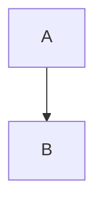

# 导出语料

这一段带 **粗体**、*斜体*、~~删除线~~、`行内代码`、==高亮==、上标 x^2^、下标 H~2~O、
emoji :smile:、转义 \*不是斜体\*、链接 [CodeMirror](https://codemirror.net "官网")、
自动链接 <https://example.com> 和脚注引用[^1]。

[TOC]

## 列表

- 无序项一
- 无序项二
  - 嵌套项
- [ ] 待办未完成
- [x] 待办已完成

1. 有序项一
2. 有序项二

## 引用与告示块

> 普通引用第一行
> 第二行

> [!warning] 小心
> 告示块的正文。
>
> 第二段也算同一张卡。

> [!note]
> 不写标题就补类型名。

---

带 **粗体** 的 setext 标题
------------------------

## 代码

```ts
const greet = (name: string): string => `你好，${name}`
```

    缩进代码块
    第二行



## 表格

| 左对齐 | 居中 | 右对齐 |
|:-------|:----:|-------:|
| a      |  b   |      c |
| **粗** | `码` | [l](x) |

## 数学

行内公式 $E = mc^2$，以及块级：

$$
\int_{-\infty}^{\infty} e^{-x^2}\,dx = \sqrt{\pi}
$$

## 图片与引用式链接


引用式链接 [文字][ref]。

[ref]: https://example.com "引用定义"

<div class="raw">裸 HTML 原样显示</div>

[^1]: 脚注定义里也能写 **粗体**。
